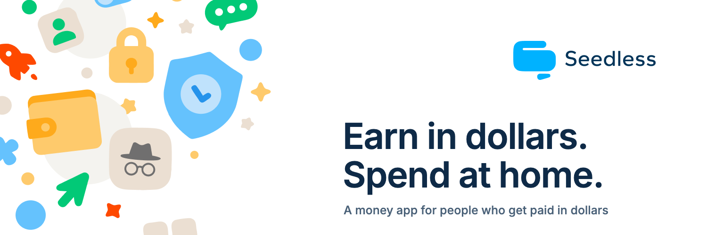

  

### francis codex

head of product engineering at [seedless labs](https://seedlesslabs.xyz). building seedless, a money app for people who get paid in dollars. runs on solana, no seed phrase, dollars to a nigerian bank account in about a minute.

engineer since 2021, building on solana since 2021. rust, anchor, pinocchio, typescript, react native, cloudflare workers.

devrel for solana builders since 2024, with superteam nigeria since 2023. facilitated *bridge to solana: from evm to svm* alongside the solana foundation, superteam nigeria and magicblock.

what we ship at [seedless labs](https://github.com/seedless-labs):
- **seedless**: the money app, live on the app store, google play and the solana dapp store
- **[leash](https://github.com/seedless-labs/leash)**: an ai agent pays invoices from a solana vault, every spend rule enforced on-chain by squads v4
- **[leash-pay](https://github.com/seedless-labs/leash-pay)**: the same policy gate for paypal, with owner approvals, caps and a kill switch

4 solana hackathon wins, including bags, umbra and 100xdevs.

[x](https://x.com/francis_codex) · [seedless labs](https://github.com/seedless-labs) · [seedlesslabs.xyz](https://seedlesslabs.xyz)
